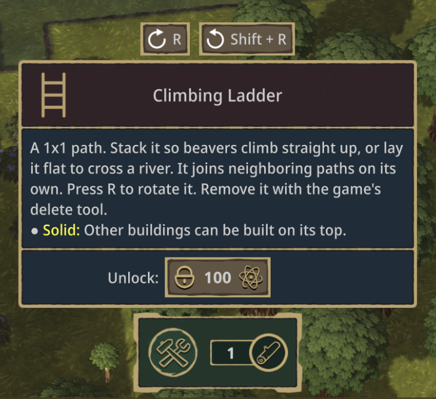

# Climb Ladder

[中文](README.md)



Current version **0.1.2**.

Tall workshops, stacked housing, doors on the second floor but no way up? Vanilla stairs are bulky and awkward along an outside wall. This mod adds **Climbing Ladder**: a 1×1 path building you **stack vertically** to link ground-level roads to upper entrances. Beavers climb to work, haul goods, and stay connected to the district network. Build and delete with the game's own path and demolition tools.

## What it does

- Adds **Climbing Ladder** to the **Paths** tool group.
- **Main use**: stack along a building face or scaffold column to reach each floor's door from the road below.
- **Also**: you can lay it flat on one level for short spans (e.g. a narrow gap); vertical access is the focus.
- Can be placed on an existing road without occupying the road's Path slot.
- Neighboring paths connect automatically in most cases.
- When the ladder starts on the ground and the building sits above, entrance wiring tries to follow vanilla doorstep rules.
- Costs **1 log** and **100** science.
- Remove with **building demolition**; a full vertical stack can be box-selected at once.

## Requirements

- Game version **1.1.0.0** or newer

## Build & install

```bash
cd src && dotnet build -c Release
cd .. && bash tools/deploy.sh
```

Default install path: `~/Documents/Timberborn/Mods/ClimbLadder`. Fully quit the game after updating files.

## Further reading

- Player guide: [docs/usage.en.md](docs/usage.en.md)
- Player update notes: [CHANGELOG.players.en.md](CHANGELOG.players.en.md)
- Steam Workshop text: [docs/workshop.en.txt](docs/workshop.en.txt) · [docs/workshop.zh.txt](docs/workshop.zh.txt)
- Design notes: [docs/en.md](docs/en.md)

MIT License — see [LICENSE](LICENSE)