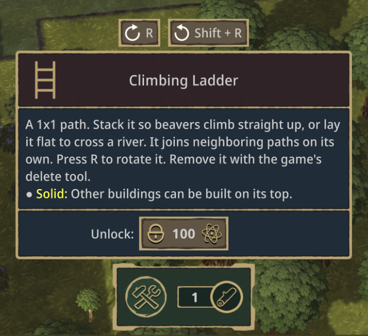

# 攀爬梯

[English](README.en.md)



多层楼房、高台仓库，门口在二楼却够不到？原版楼梯要么占地大，要么很难贴着外墙一格格往上接。这个 mod 增加 **攀爬梯**：1×1 的道路建筑，在同一格竖着叠，给高层建筑当「竖向通道」，海狸能上下楼、送货、上班。建造和拆除都用游戏自带的路径、删除工具。

## 它做什么

- 在**路径**工具组里提供「攀爬梯」。
- **主要用途**：贴着建筑外墙或独立支架，一格一格往上叠，把地面道路接到各层门口。
- **顺带**：同一高度也可以平铺（例如窄河面的一小段），玩法上以竖向为主。
- 可以叠在已有道路上（不占道路的 Path 格）。
- 挨着道路会自动接上，一般不需要再手画道路连线。
- 楼下是路、楼上是房门时，会尽量按门口连通规则接入路网。
- 建造消耗 **1 根原木**，科研 **100** 科学点。
- 用游戏的**拆除建筑**工具框选删除；竖向叠放的整列会一起选中。

## 要求

- 游戏版本不低于 **1.1.0.0**

## 构建与安装

```bash
cd src && dotnet build -c Release
cd .. && bash tools/deploy.sh
```

默认安装到 `~/Documents/Timberborn/Mods/ClimbLadder`。改完文件后请完全退出游戏再进。

## 进一步阅读

- 玩家使用说明：[docs/使用说明.md](docs/使用说明.md)
- 创意工坊文案：[docs/workshop.zh.txt](docs/workshop.zh.txt) · [docs/workshop.en.txt](docs/workshop.en.txt)
- 设计与实现记录：[docs/zh.md](docs/zh.md)

MIT License — 见 [LICENSE](LICENSE)