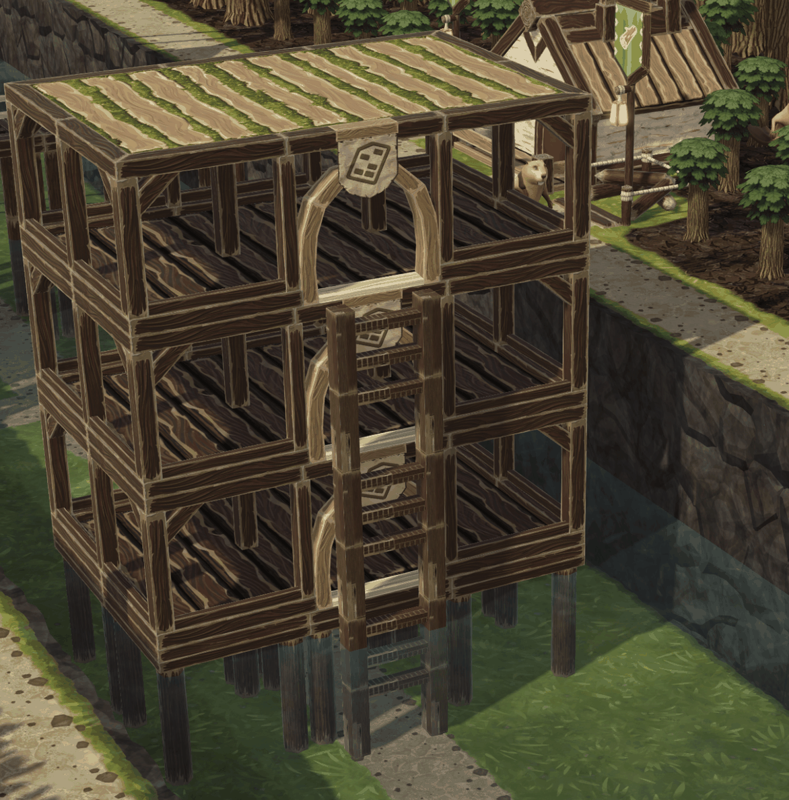
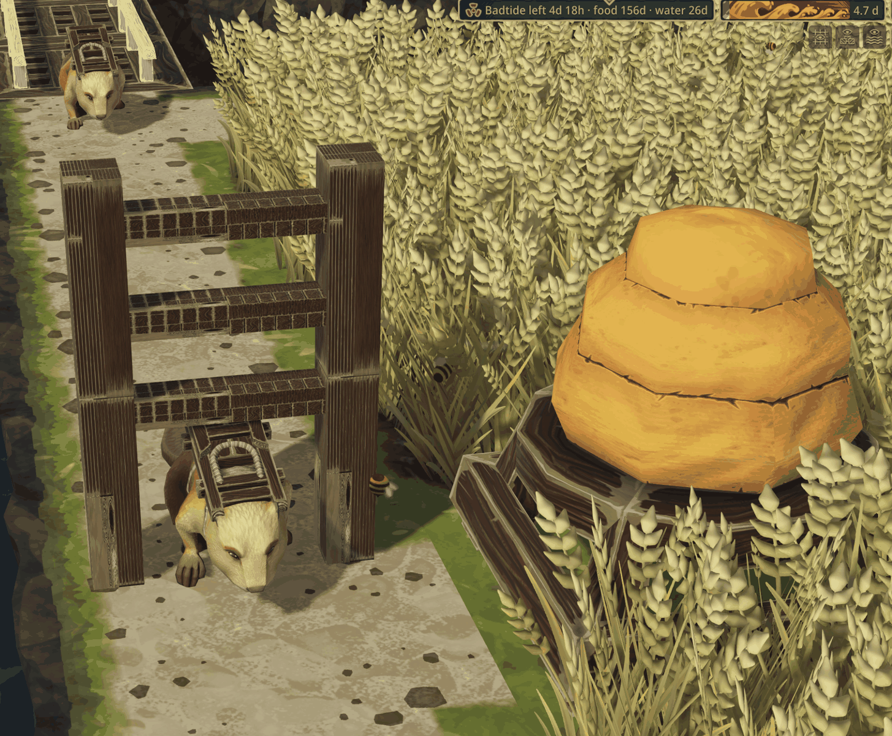
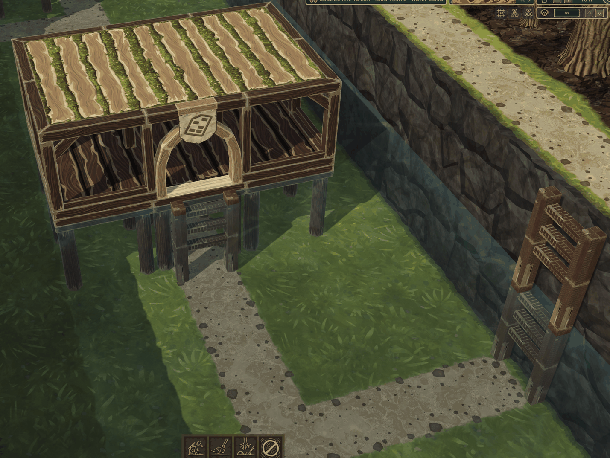

# Climb Ladder — Player guide

[中文](使用说明.md) · [Steam Workshop text](workshop.en.txt)

Version 0.1.0

**Climbing Ladder is mainly for tall buildings.** Stack it in a 1×1 column to link ground-level roads to doors on upper floors so beavers can commute and haul goods. It uses the same materials and demolition rules as other path buildings. You *can* lay it flat on one level for a short gap (narrow ditch, tiny river span) — that is a side option, not the main purpose.

## Before you start

1. Game version **1.1.0.0** or newer
2. Enable **Climb Ladder** in the mod list (Id: `Jove.ClimbLadder`)
3. Fully quit the game and launch again, or reload your save

## Unlocking

Unlock **Climbing Ladder** in the science panel.

| Item | Cost |
|---|---|
| Science | **100** |
| Build cost | **1** log per cell |

## Placing (what most players do)

1. Open the **Paths** tool group and select **Climbing Ladder**.
2. **Stack upward** along a building wall or scaffold:
   - Start on the cell where you already have ground / road.
   - Stack in the same X/Y until you reach the floor height you need.
   - Place the top cell where beavers can reach the door.
3. **Tie into horizontal roads** at the bottom (and at any intermediate platform).
4. **On an existing road cell**: road and ladder can share the cell (ladder does not take the Path slot).
5. Press **R** to rotate when needed (vertical stacks often need the default facing).

### Optional: flat on one level

For a single missing tile or a very short bridge at one height, drag sideways and connect both ends to your road network. **For multi-story bases, keep stacking vertically.**

## Beavers and buildings

- Ladder cells are walkable road; beavers move up and down the column.
- **Multi-floor** housing, storage, and workshops rely on this link for district connectivity.
- If a building still shows as disconnected, align the top of the stack with the door and ensure the bottom joins your roads. The mod helps wire doorsteps when the ladder starts below the floor.

## Removing

| Situation | How |
|---|---|
| Finished ladder | **Building demolition** tool |
| Tall stack | Box-select the column to delete it together |
| Refund | Same rules as other path buildings |

## Compared with vanilla stairs

| | Vanilla stairs | Climbing Ladder |
|---|---|---|
| Typical play | Indoors / fixed stair slots | Outside vertical path along a tower |
| Footprint | Often 1×1×2 | 1×1×1, stack per floor |
| Roads | Planned separately | Is a road segment |
| Share cell with road | Depends | Yes (no Path occupation) |

## FAQ

**Upper floor still disconnected?**  
Check stack height, door alignment, and road at the base; rebuild the top or bottom cell if needed.

**Paths do not auto-connect?**  
Both sides need a road or ladder; fully quit after mod updates.

**Only for river crossing?**  
Possible for a short flat line, but the mod shines on **vertical** access — vanilla paths are often simpler for long flat spans.

**Only one cell deletes?**  
Use demolition box-select on version **0.1.0**+.

## Feedback & source

- Email: jove.rina@outlook.com
- GitHub: `git@github.com:rina-games/TimberbornClimbLadderMod.git`