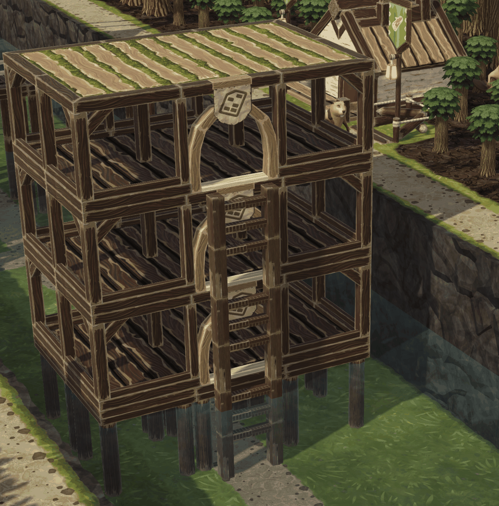
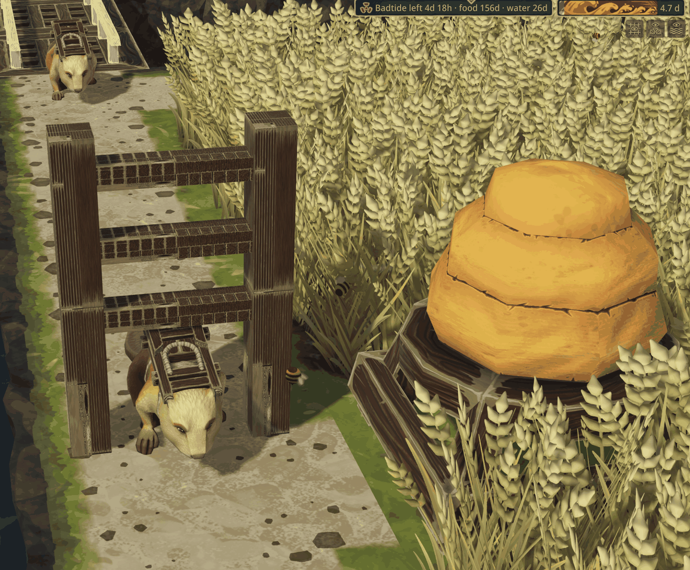
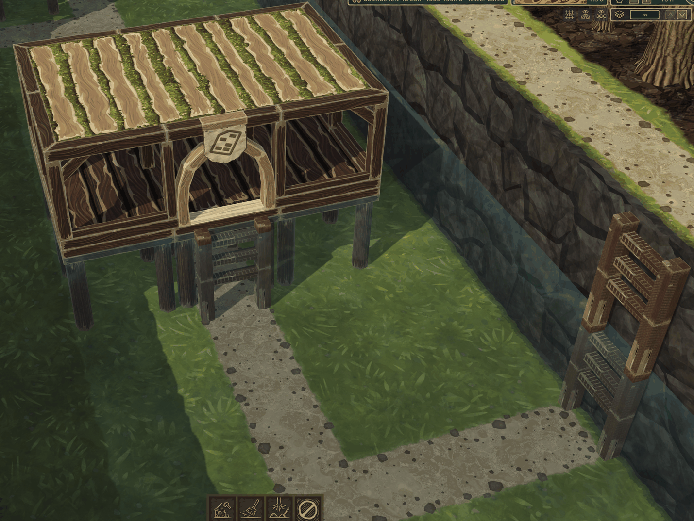

# 攀爬梯 — 使用说明

[English](usage.en.md) · [创意工坊文案](workshop.zh.txt)

版本 0.1.0

**攀爬梯主要给高层建筑用**：在 1×1 的格子里竖着叠，把楼下的路和楼上各层的门口接起来，海狸能上下办公、搬运。它仍是道路建筑，材料和拆除方式和原版一样。同一格偶尔也可以平铺一小段（比如窄沟、小河），那是辅助用法，不是设计重点。

## 需要准备什么

1. 游戏版本不低于 **1.1.0.0**
2. 在模组列表里启用 **Climb Ladder**（Id：`Jove.ClimbLadder`）
3. 完全退出游戏后再进，或重新加载存档，让模组生效

## 怎么解锁

在**科学**面板里解锁「攀爬梯」。

| 项目 | 数值 |
|---|---|
| 科研花费 | **100** 科学点 |
| 建造消耗 | **1** 根原木（每格） |

## 怎么放置（玩家最常用）

1. 打开底部工具栏的**路径**工具组，选择「攀爬梯」。
2. **贴着建筑或支架竖着叠**：
   - 从最底下有路/地面的那一格开始，在同一坐标往上叠到目标楼层高度。
   - 最上一格尽量在房门正下方或侧面能接到门口的位置。
3. **和水平道路衔接**：底层第一格接上路网；中间某层若也有平台/走廊，可在该高度再接一段路。
4. **叠在已有道路上**：同一格可以既有路又有梯子（梯子不占道路的 Path 格）。
5. 需要转向时按 **R**（竖向叠放一般用默认朝向即可）。

### 顺带：同一层平铺

如果只是同一高度上缺一小格、或一条很短的桥面，可以在该高度用侧面拖出一格/几格，并接在路网两侧。**高楼上下仍以竖向叠放为主**。

## 和海狸、建筑的关系

- 攀爬梯算道路，海狸会沿梯子列上下移动。
- 仓库、工房、住宅等**多层建筑**依赖这列梯子把各层门口连进地区路网。
- 游戏会检查门口内外是否接通；梯子从地面接到楼下时，模组会尽量补门口那一段。若仍提示「未连接道路」，检查最上一格是否对着门、整列是否接到你画好的路。

## 怎么拆除

| 情况 | 做法 |
|---|---|
| 已建成的攀爬梯 | 用游戏的**拆除建筑**工具（不是挖地形） |
| 竖向叠了很多格 | 框选同一列，整列高亮后一次拆掉 |
| 回收 | 按原版路径建筑的退还规则 |

## 和原版楼梯的区别

| | 原版楼梯 | 攀爬梯 |
|---|---|---|
| 典型场景 | 室内或固定楼梯位 | 外墙 / 脚手架旁的竖向通道 |
| 占地 | 常 1×1×2，不易密叠 | 1×1×1，按层自由叠高 |
| 与道路 | 需另外规划 | 本身就是道路，可接路网 |
| 同格道路 | 视规则而定 | 可与道路同格（不占 Path） |

## 常见问题

**高层房门还是未连接？**  
确认梯子顶格在门口可达高度，且底层已接路；必要时拆掉顶/底一格重放。

**道路没有自动连上？**  
两侧要有路或攀爬梯；改模组后完全退出再进。

**只想过河，值得用攀爬梯吗？**  
可以铺一小段，但更推荐当竖向楼梯的替代品；过河用原版道路往往更省心。

**拆除只能选中一格？**  
用拆除建筑框选，版本需为 0.1.0 及以上。

## 反馈与源码

- 邮箱：jove.rina@outlook.com
- GitHub：`git@github.com:rina-games/TimberbornClimbLadderMod.git`